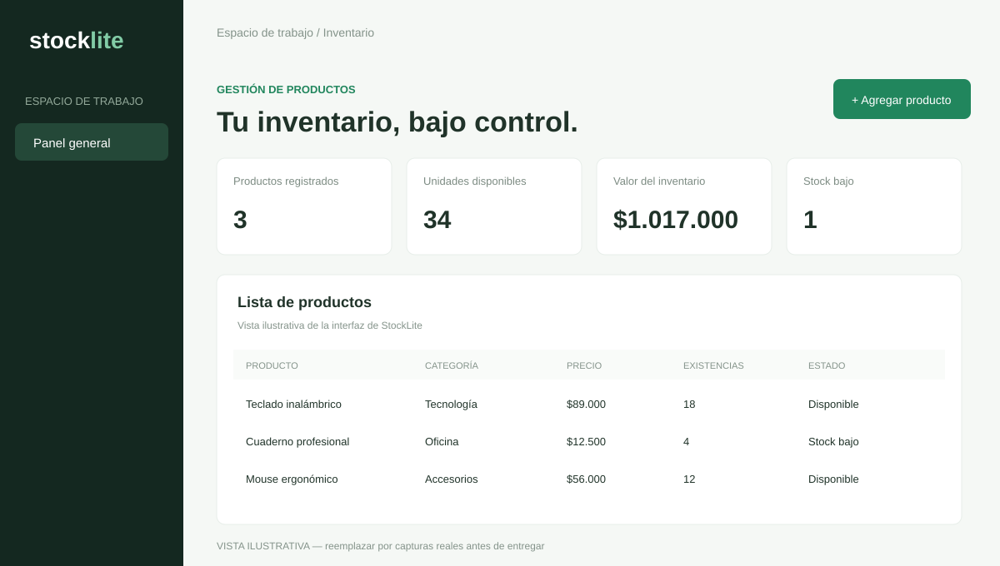

# StockLite — Aplicación web CRUD de inventario

**Autor:** Andrés Sebaxtian Vargas Bermeo  
**Programa:** Ingeniería de Software  
**Seminario:** Gestión de Software Ágil asistido por Inteligencia Artificial

## Descripción
StockLite es una aplicación web académica para administrar productos de inventario. Permite crear, consultar, actualizar y eliminar productos desde una interfaz sencilla y adaptable.

El desarrollo fue guiado con prompts de IA para definir requisitos, proponer la interfaz, implementar las operaciones CRUD, agregar validaciones y preparar la documentación. El estudiante debe revisar el código, probar cada función y poder explicar las decisiones tomadas.

## Tecnologías
- HTML5: estructura de la aplicación.
- CSS3: estilos y diseño adaptable.
- JavaScript: lógica CRUD, validaciones, búsqueda y filtros.
- LocalStorage: almacenamiento de los datos en el navegador.
- GitHub: publicación del código fuente.

No requiere Node.js, instalación de paquetes ni base de datos.

## Cómo ejecutar
1. Abre el repositorio en GitHub y descarga el proyecto con **Code → Download ZIP**, o clónalo.
2. Extrae los archivos si descargaste el ZIP.
3. Abre el archivo `index.html` en Chrome, Edge o Firefox.
4. Para trabajar desde Visual Studio Code, abre la carpeta del proyecto y ejecuta `index.html` con Live Server.

También puedes iniciar un servidor local desde la carpeta del proyecto con `python -m http.server 5500` y entrar a `http://localhost:5500`.

## Funciones disponibles
- **Create:** agregar un producto con nombre, categoría, cantidad y precio.
- **Read:** consultar los productos en una tabla, con búsqueda y filtro por categoría.
- **Update:** editar la información de un producto existente.
- **Delete:** eliminar un producto después de confirmar la acción.
- Validación de campos y actualización automática de indicadores.
- Persistencia en el navegador mediante LocalStorage.

## Alcance y limitaciones
Esta versión es un prototipo frontend. LocalStorage conserva los registros solamente en el navegador y computador donde se utiliza. No hay servidor, autenticación, roles ni base de datos compartida. Al borrar los datos del sitio o cambiar de navegador, los registros pueden dejar de estar disponibles.

## Estructura del repositorio
- `index.html`: aplicación, estilos y lógica JavaScript.
- `PROMPTS.md`: prompts de referencia y explicación de su propósito.
- `GUION_VIDEO.md`: guion para grabar la demostración de máximo 10 minutos.
- `capturas/preview.svg`: vista ilustrativa de la interfaz.

## Prompts de IA
Consulta [PROMPTS.md](PROMPTS.md). El documento registra prompts de referencia para requisitos, tecnologías, interfaz, CRUD, validaciones, revisión y documentación. En el video muestra tu conversación real con la IA y explica qué instrucciones utilizaste.

## Capturas de pantalla
La imagen en la carpeta `capturas` es una **vista ilustrativa**, no una captura real de una sesión ejecutada en tu computador. Antes de entregar, reemplázala o complétala con capturas propias de StockLite funcionando: panel principal, creación, edición y eliminación.

## Video de demostración
**Enlace del video:** PENDIENTE_DE_GRABAR_Y_AGREGAR

Graba pantalla y voz (máximo 10 minutos), mostrando prompts, revisión del código y las cuatro operaciones CRUD en tiempo real. Sube el video a YouTube, Google Drive u OneDrive y reemplaza este texto por el enlace compartido con permisos para el docente.

Consulta el [guion del video](GUION_VIDEO.md).

## Uso de inteligencia artificial
Se utilizó ChatGPT como apoyo para estructurar el proyecto, generar y revisar código, definir validaciones y preparar documentación. La IA no sustituye la revisión: el estudiante debe ejecutar el proyecto, comprobar los resultados, comprender el código y declarar su uso.

---
**Proyecto académico — StockLite CRUD**
